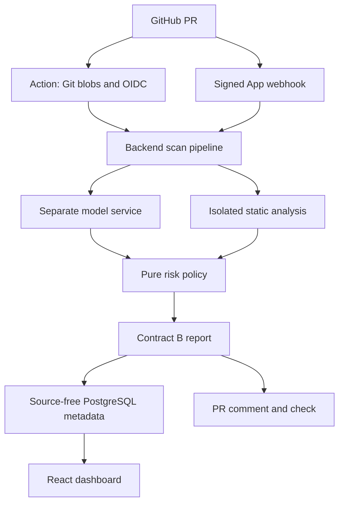

# Architecture

## Canonical repository
https://github.com/rudiously/CodeSentinel — default main; verified empty through the GitHub connector. Initial contents write rejected with HTTP 403 Resource not accessible by integration; no source uploaded, no remote branch/commit exists. Account metadata push permission does not establish connector write scope. H11 records exact remediation.

## System and PR data flow

Primary Action: validated Git base/head SHAs → read complete blobs without executing source → GitHub OIDC authorizes /scan for allowlisted repository → API report → comment using GITHUB_TOKEN → PASS/WARN exit 0, BLOCK 1, ERROR 2. App: verify raw HMAC before parsing → bounded per-process delivery cache → fixed GitHub API blobs → stable-head checks → same report pipeline → comment/check. Partial diff hunks are never guessed to be complete source. Optional /scan diff selects changed functions from complete post-change files. Static findings outside selected functions remain safety-relevant.

| Component / owning folder | Responsibility | Inputs | Outputs |
|---|---|---|---|
| shared/ | Executable schemas, bounded body buffering, uniform errors | Validated JSON/raw HTTP | Contracts A/B and errors |
| ml/ | Provenance, clean/split, train, calibration, IG, TorchScript parity/registry | Dataset/config | Versioned SMOKE/TRAINED artifact and measured reports |
| model_service/ | Contract C CPU inference, integrity, limits, metrics | Code/language, trusted artifact dir | Probability, label, attribution, provenance |
| backend/ | Auth, extraction, static tools, risk, reports, DB and GitHub | Source/blobs/diffs/webhooks | ERROR or PASS/WARN/BLOCK report, metadata/comment/check |
| frontend/ | Six React pages, transient source and provenance | Live API or shared SYNTHETIC mocks | Review dashboard; npm/browser unverified |
| action/ | Runner-side primary PR gate | Git blobs, built-in OIDC and GITHUB_TOKEN | API call, safe metadata comment, exit code |
| deploy/ | Seven services, automatic migrations, metrics/dashboard provisioning | Environment secrets and image definitions | Stack definitions; live runtime blocked |
| fixtures/, examples/, scripts/ | Shared illustrative contracts, safe/unsafe snippets, verification | Labelled demo inputs | Tests, synthetic seed, offline and LIVE gates |

## Risk and failure policy
`risk = min(1, w_model*p + w_static*s + bonus)`; default weights .5/.5, bonus .1 only if p>=.5 and s>=.6. Severity is max(High=1, Medium=.6, Low=.3), or zero. PASS <.35; WARN <.65; BLOCK otherwise. High finding forces at least WARN, even in model_only when supplied. model_only score=p; static_only score=s and makes no model call. Weights sum to one and ordered thresholds are validated. Failures return ERROR/null risk; no silent stub fallback for a failed loaded artifact or unavailable model. reasons name functions, rules, locations and signal values.

## Current implementation and limits
Python implementation and in-process integration are verified in installed Python 3.13; pinned Python 3.11 setup is blocked. Native tree-sitter/Bandit/cppcheck verification, npm/browser, live sockets/Docker, audits and trained-model data/evaluation are blocked. Stub defaults remain explicit. A tiny random RoBERTa SMOKE artifact has actual CPU train/export/parity/registry/attribution/HTTP/integrity evidence. No trained CodeBERT or reproduced benchmark exists.

The default extractor uses tree-sitter; ALLOW_PYTHON_AST is an opt-in Python fallback. STATIC_ANALYSIS_MODE=builtin-python is a small transparent AST rule set, not Bandit. Reports carry analysis provenance. Scanned source is never executed. Stored history excludes source and token strings, so historical code viewer explains unavailable source. Model artifacts/manifests must come from trusted distribution; SHA256 alone is not authenticity. Users share one configured installation; no tenant ownership isolation.

## Technology decisions
Python 3.11 target, FastAPI/Pydantic v2, pydantic-settings, SQLAlchemy 2/Alembic/PostgreSQL (SQLite tests), httpx bounded clients, tree-sitter native grammars, Bandit/cppcheck fixed subprocess argv. React/Vite/TypeScript/Tailwind/Recharts frontend. ML uses existing CodeBERT/Transformers/PyTorch, MLflow sqlite tracking/registry and TorchScript. Docker Compose, Prometheus/Grafana and GitHub Actions define delivery. Direct dependencies/base tags pinned; transitive npm lock and audits await network.

## Dated Decision Log
- 2026-10-22: PM execution prompt overrides proposed source details; Project.md/Work.md remain immutable. Earlier metrics are earlier run, not reproduced. Proposed dataset counts are not accepted as measured.
- 2026-10-22: Use current root, not nested codesentinel/. Added shared/ for contracts/HTTP controls and fixtures/ for reusable SYNTHETIC examples; scripts are importable for testability.
- 2026-10-22: Git initialization denied. Do not mutate inherited ancestor git repository or claim commits. Continue with accurate per-task handoff (H1).
- 2026-10-22: Exact pinned install failed; use explicit installed-tool VENV override and PYTHON_ONLY=1 for offline checks. Default Make targets include frontend; Python-only is not a full pass.
- 2026-10-22: Contracts v1.0–v1.3 add ERROR, explicit STUB/SMOKE/TRAINED/UNAVAILABLE provenance, analysis metadata, source-free history, exact auth and /scan error semantics. Consumers and shared/frontend fixtures updated together.
- 2026-10-22: Conservative complete-blob scanning avoids invalid diff context. GitHub whole-file scans may flag pre-existing issues; unsupported changed file types fail closed for manual review.
- 2026-10-22: Risk is clamped to one to match finite [0,1] Contract B. Ablation scores use unmixed signals; High safety floor remains when static findings are supplied.
- 2026-10-22: Native tools absent; explicit AST/builtin alternatives allow offline verification without pretending native tooling passed. Full M1 stays blocked; independent downstream implementation does not advance unresolved gates.
- 2026-10-22: Verified dataset identity is google/code_x_glue_cc_defect_detection, Devign-derived CodeXGLUE, upstream C-UDA notes. Actual download/counts/revision remain pending. Pool exact-clean records then seeded stratified 80/10/10 sample split; do not claim original split preservation or repo-level holdout.
- 2026-10-22: Choose permitted TorchScript export instead of unavailable ONNX. Smoke uses tiny random RoBERTa/character tokenizer/synthetic samples, never pretrained CodeBERT. SMOKE metrics hidden from normal model-info performance. Numerical parity tested on fixed max-length inputs and multiple batch sizes; no universal numerical guarantee.
- 2026-10-22: Installed MLflow rejects legacy file-store by default. Use sqlite tracking/registry; SMOKE registry separated from TRAINED. Versioned raw TorchScript registry artifacts are not falsely advertised as MLflow pyfunc flavor.
- 2026-10-22: Integrated gradients use class-logit difference, zero embedding reference, default eight midpoint steps; approximate sensitivity only. Export includes embed/from_embeddings methods. Runtime can disable attribution; legacy artifacts return empty values.
- 2026-10-22: Full train selects CUDA when available, CPU otherwise, with batched validation/test to avoid full-split OOM; best checkpoints persist beside versioned output. No automated resume or GPU-run claim.
- 2026-10-22: JWT protects API by default; production rejects dev login/weak secrets/disabled auth. OAuth is browser-bound and allowed-user configured. Add GitHub OIDC only on /scan so the primary gate needs no manually stored expiring API JWT. Local RSA/mocked tests pass; actual GitHub OIDC awaits H6. Primary reference: https://docs.github.com/en/actions/reference/security/oidc .
- 2026-10-22: Logs omit source/tokens; disable access query logs; hide settings input on validation failure. Redact external analyzer messages to rule/severity descriptions before persistence. Durable multi-worker dedup/quotas remain limitations.
- 2026-10-22: Containers/configs/workflows are static-validated only. Loopback and Docker socket denied; npm DNS/cache and audit dependencies unavailable. No full-stack, browser, CI-green, audit-clean, publish or deployment claim. STRETCH remains deferred.

- 2026-10-22: Contract v1.4 adds latest_scan metadata to repository summaries, with frontend/mocks/type/persistence consumers updated together. Analytics includes a repository selector over recent returned scans.

- 2026-10-22: PM selected rudiously/CodeSentinel as canonical repository. Connector read access works, shell Git DNS fails, connector writes return 403. No remote contents changed. README/notebook/repo allowlist and H11 updated; no credentials or broad permissions changed.
- 2026-10-22: Corrected Contract B aggregate to combine scan-wide maxima, matching Document 10; retain per-function drill-down. Corrected policy evaluation to count actual decisions (including safety floors), reject non-finite scores/ERROR analyses, preserve synthetic provenance and check leakage before inference. See Contract v1.5.

## Actual current source tree
Generated from disk; runtime .venv/cache/MLflow/database/weight contents are excluded below, not claimed absent. models/ contains ignored SMOKE versions/checkpoints in addition to README.md. Empty k8s/ is a deferred placeholder, not implemented Kubernetes.

| Folder | Actual files |
|---|---|
| `.` | `.dockerignore`, `.editorconfig`, `.env.example`, `.gitignore`, `Architecture.md`, `Contracts.md`, `Conventions.md`, `HumanActions.md`, `Makefile`, `Progress.md`, `Project.md`, `README.md`, `Security.md`, `Tasks.md`, `TestPlan.md`, `Work.md`, `pyproject.toml`, `requirements-dev.txt` |
| `.github/workflows` | `ci.yml`, `codesentinel-gate.yml`, `release.yml` |
| `action` | `__init__.py`, `action.yml`, `gate.py` |
| `action/tests` | `test_gate_cli.py` |
| `backend` | `Dockerfile`, `__init__.py`, `alembic.ini`, `requirements.txt` |
| `backend/alembic` | `env.py` |
| `backend/alembic/versions` | `0001_initial.py` |
| `backend/app` | `__init__.py`, `logging.py`, `main.py`, `metrics.py`, `settings.py` |
| `backend/app/api` | `auth.py`, `webhook.py` |
| `backend/app/core` | `__init__.py`, `errors.py`, `oidc.py`, `rate_limit.py`, `security.py` |
| `backend/app/db` | `__init__.py`, `models.py`, `repositories.py`, `session.py` |
| `backend/app/schemas` | `__init__.py` |
| `backend/app/services` | `__init__.py`, `diff_parser.py`, `function_extractor.py`, `github_client.py`, `model_client.py`, `report_builder.py`, `risk_engine.py` |
| `backend/app/services/static_analysis` | `__init__.py`, `bandit_runner.py`, `base.py`, `cppcheck_runner.py`, `python_rules.py` |
| `backend/tests/api` | `test_auth.py`, `test_foundation.py`, `test_observability.py`, `test_webhook.py` |
| `backend/tests/integration` | `test_github.py`, `test_persistence.py`, `test_scan.py` |
| `backend/tests/unit` | `test_extraction.py`, `test_oidc.py`, `test_risk.py`, `test_static.py` |
| `deploy` | `docker-compose.dev.yml`, `docker-compose.yml` |
| `deploy/grafana/dashboards` | `codesentinel.json` |
| `deploy/grafana/provisioning/dashboards` | `default.yml` |
| `deploy/grafana/provisioning/datasources` | `prometheus.yml` |
| `deploy/k8s` | (empty placeholder) |
| `deploy/mlflow` | `Dockerfile` |
| `deploy/prometheus` | `prometheus.yml` |
| `docs` | `demo-script.md`, `model-card.md`, `viva-notes.md` |
| `docs/architecture-diagrams` | `system.md` |
| `docs/evaluation` | `ablation.md`, `error-analysis.md`, `latency.md`, `model-metrics.md`, `smoke-results.json`, `thresholds.md` |
| `docs/report` | `outline.md`, `section-drafts.md` |
| `examples` | `__init__.py`, `seed_demo_data.py`, `smoke_test.jsonl`, `smoke_validation.jsonl` |
| `examples/clean` | `add.c`, `add.py` |
| `examples/vulnerable` | `eval_input.py`, `overflow.c` |
| `fixtures` | `prediction.json`, `scan_report.json` |
| `frontend` | `Dockerfile`, `eslint.config.js`, `index.html`, `nginx.conf`, `package.json`, `postcss.config.js`, `tailwind.config.js`, `tsconfig.json`, `vite.config.ts` |
| `frontend/src` | `App.tsx`, `main.tsx` |
| `frontend/src/api` | `client.ts`, `types.ts` |
| `frontend/src/components` | `common.tsx` |
| `frontend/src/hooks` | `useResource.ts` |
| `frontend/src/mocks` | `index.ts`, `scan_report.json` |
| `frontend/src/pages` | `Analytics.tsx`, `Login.tsx`, `ModelInfo.tsx`, `Repos.tsx`, `ScanDetail.tsx`, `ScanHistory.tsx` |
| `frontend/src/styles` | `main.css` |
| `frontend/tests` | `report.test.tsx`, `setup.ts` |
| `ml` | `__init__.py`, `calibrate.py`, `evaluate.py`, `evaluation_run.py`, `explain.py`, `export.py`, `predictor.py`, `register.py`, `requirements.txt`, `runtime.py`, `train.py` |
| `ml/configs` | `eval.yaml`, `train_codebert.yaml`, `train_smoke.yaml` |
| `ml/data` | `README.md`, `__init__.py`, `clean.py`, `download.py`, `split.py` |
| `ml/notebooks` | `colab_train.ipynb` |
| `ml/tests` | `test_contracts.py`, `test_data_and_metrics.py`, `test_evaluation_provenance.py`, `test_explain.py`, `test_foundation.py`, `test_predictor.py` |
| `model_service` | `Dockerfile`, `__init__.py`, `requirements.txt`, `stub_model.py` |
| `model_service/app` | `__init__.py`, `main.py`, `metrics.py`, `schemas.py`, `settings.py` |
| `model_service/tests` | `test_stub.py` |
| `models` | `README.md` |
| `scripts` | `__init__.py`, `e2e_demo.py`, `e2e_demo.sh`, `smoke_test.py`, `smoke_test.sh`, `verify_smoke_artifact.py`, `wait_for_services.sh` |
| `shared` | `__init__.py`, `http.py`, `schemas.py` |
