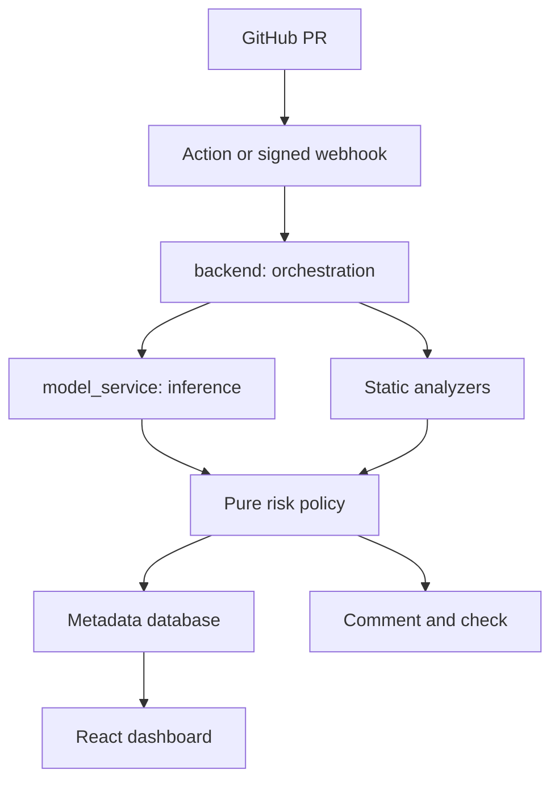

# Component ownership

Shared schemas own Contracts A/B. ML owns data/train/calibrate/export/register/explain. Deploy owns healthchecks, monitoring and image definitions. See Architecture.md for actual tree, status and decision log.
